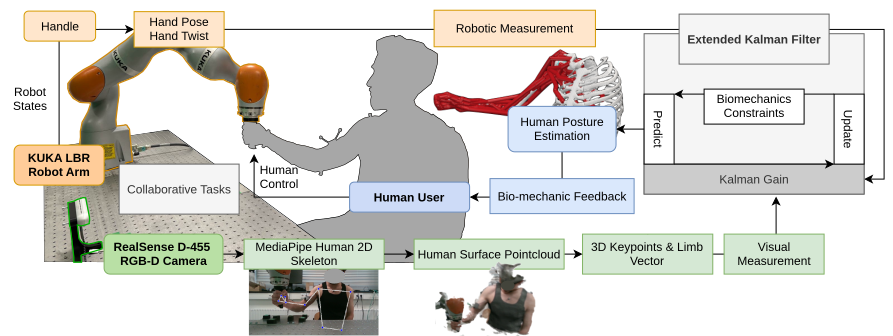

# Real-time arm pose estimation during pHRI

The software of our paper "Real-Time Arm Posture Estimation During Physical Human–Robot
Interaction via Camera–Robot Sensor Fusion".

It estimates, in real time, the 7-DOF pose of a human right arm whose hand holds a robot. An
extended Kalman filter fuses the robot-measured hand pose with arm keypoints from an RGB-D
camera. [docs/overview.md](docs/overview.md) briefly describes the code.

<p align="center">
  
</p>

## Installation

Ubuntu 24.04, ROS 2 Jazzy.

```bash
mkdir -p ~/pose_ws/src && cd ~/pose_ws/src
git clone https://github.com/TUD-HRC/robot_rgbd_arm_pose_estimation.git
cd ~/pose_ws
source /opt/ros/jazzy/setup.bash
rosdep install --from-paths src --ignore-src -r -y
colcon build --symlink-install
source install/setup.bash
```

This is enough to run the recordings. For RViz to draw the robot, also build `lbr_description`
(the robot's meshes) from [lbr_fri_ros2_stack](https://github.com/lbr-stack/lbr_fri_ros2_stack),
on the branch for your ROS distribution, in the same workspace.

Running live also needs MediaPipe and OpenCV, which come
from `pip`. Put them in a virtual environment next to `src/` and build with it:

```bash
cd ~/pose_ws
python3 -m venv venv && touch venv/COLCON_IGNORE
./venv/bin/pip install "mediapipe==0.10.21" opencv-contrib-python "numpy<2"
colcon build --symlink-install --cmake-args -DARM_POSE_VENV=$PWD/venv
source install/setup.bash
```

Sourcing the workspace then puts the venv on `PYTHONPATH`; it never has to be activated.
MediaPipe must stay at 0.10.21, the last version with the `mp.solutions` API.

## Running

Everything runs from one launch file, `arm_pose_estimation.launch.py`.

### On a recording

The 20 recordings of the study (participants 1–10, trials A and B) hold the robot's data and the
precomputed output of the vision front end (the 3D shoulder, elbow and wrist), but no images or
point clouds. They come with the motion-capture reference. They are not in this repository:
download them as [data/README.md](data/README.md) says and put them into `data/`. Then play one
by passing it as `bag`:

```bash
DATA=~/pose_ws/src/robot_rgbd_arm_pose_estimation/data
ros2 launch arm_pose_estimation arm_pose_estimation.launch.py subject_id:=1 trial:=A \
    bag:=$DATA/recordings/subject_01_trial_A.mcap
```

The launch file plays the recording in real time and stops when it ends. `subject_id` and
`trial` must match the recording: they select the subject's arm lengths and the grip offset
fitted to that trial.

### Live

Start the camera and the robot drivers first. We used a RealSense D455 (`realsense2_camera`,
color and depth at 640×480, 30 fps, with the organized point cloud aligned to the color image)
and a KUKA LBR iiwa 7 ([lbr_fri_ros2_stack](https://github.com/lbr-stack/lbr_fri_ros2_stack)).
Then:

```bash
ros2 launch arm_pose_estimation arm_pose_estimation.launch.py subject_id:=1
```

Live, the launch file also starts MediaPipe and the 3D keypoint solver on the camera.

### Arguments

| Argument | Default | |
|---|---|---|
| `subject_id` | `1` | subject in `config/subject_arm_lengths.yaml` |
| `trial` | | `A` or `B` on a recording: selects the grip offset |
| `bag` | | recording to play; empty: live |
| `sensors` | `fused` | `fused` (robot + camera), `robot` or `camera` only |
| `rviz` | `true` | start RViz |

### Output

| Topic | |
|---|---|
| `/arm_pose_ekf/joint_states` | the estimate: 7 joint angles (rad) and velocities (rad/s) |
| `/arm_pose_estimation/robot_description`, `/tf` | the subject's arm model, posed by the estimate |
| `/arm_keypoint_markers` | the camera's shoulder, elbow and wrist |
| `/arm_pose_ekf/cycle_timing` | computation time and delays of every filter cycle |

To keep the estimate, record it: `ros2 bag record /arm_pose_ekf/joint_states`.

### Your own setup

- `config/subject_arm_lengths.yaml`: add each new subject's upper-arm, forearm and hand
  lengths.
- `config/camera_extrinsic.yaml`: the camera pose in the robot base frame.
- `config/general.yaml`: topic and frame names of your drivers. The robot model is read from
  its `robot_description` topic, so any robot that publishes one works.
- `additional_resources/`: CAD of the handle the hand holds; `ee_to_hand` in
  `config/ekf.yaml` is the hand frame relative to the robot's end-effector link.

## License

MIT, see [LICENSE](LICENSE).

## Citation

```bib
@inproceedings{armpose,
  title     = {Real-Time Arm Posture Estimation During Physical Human--Robot Interaction
               via Camera--Robot Sensor Fusion},
  author    = {Hu, Yuxuan and Srivastava, Aditya and Peternel, Luka and Marchal-Crespo, Laura
               and Prendergast, J. Micah},
  booktitle = {},
  year      = {}
}
```

<table align="center">
  <tr><td align="center">Funding Institution</td></tr>
  <tr><td align="center"></td></tr>
</table>
